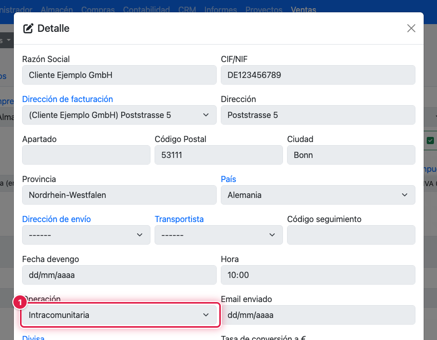
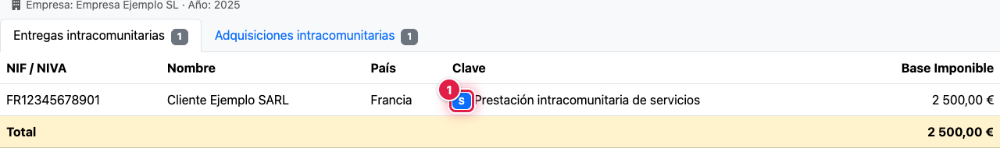
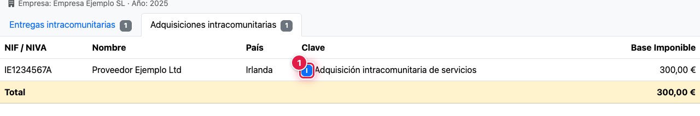

Cada operación del modelo 349 lleva una **clave** de una letra que le dice a la AEAT de qué tipo es. El plugin Modelo349 no la elige por su cuenta: la saca del campo **Operación** de cada factura. Por eso, antes de presentar el modelo, conviene comprobar que las facturas intracomunitarias tienen la operación correcta.

Además de las operaciones intracomunitarias de bienes y de servicios, el plugin añade al campo **Operación** de las facturas de venta cinco opciones más, para las claves **T**, **M**, **H**, **R** y **D**. Solo aparecen mientras el plugin está activado.

## 🔑 Qué clave sale de cada operación

| Operación de la factura | Factura de venta | Factura de compra |
|---|---|---|
| **Intracomunitaria** (bienes) | **E**: entrega intracomunitaria de bienes exenta | **A**: adquisición intracomunitaria de bienes |
| **Intracomunitaria de servicios** | **S**: prestación intracomunitaria de servicios | **I**: adquisición intracomunitaria de servicios |
| **Intracomunitaria triangular** | **T**: entrega en otro estado miembro dentro de una operación triangular | No existe en compras |
| **Intracomunitaria tras importación exenta** | **M**: entrega intracomunitaria posterior a una importación exenta | No existe en compras |
| **Intracomunitaria tras importación exenta (representante fiscal)** | **H**: la misma entrega, hecha por un representante fiscal | No existe en compras |
| **Intracomunitaria en consigna** | **R**: envío de bienes a otro estado miembro con un acuerdo de venta en consigna | No existe en compras |
| **Devolución intracomunitaria en consigna** | **D**: devolución de bienes enviados antes en consigna | No existe en compras |

Las ventas aparecen en la pestaña **Entregas intracomunitarias** y las compras, en **Adquisiciones intracomunitarias**.

Una factura con cualquier otra operación, o sin operación, no entra en el modelo aunque su cliente o proveedor sea de la UE. Solo se declaran las facturas emitidas, es decir, las que ya no se pueden editar.

## 📋 Cómo cambiar la operación de una factura

Mientras la factura siga siendo un borrador:

1. Abre la factura.
2. Pulsa el botón **Detalle**.
3. En el campo **Operación** (1), elige la operación de la tabla anterior que corresponda.
4. Guarda la factura.

Si el cliente o el proveedor siempre es intracomunitario, puedes dejar la **Operación** ya elegida en su ficha: las facturas nuevas la heredan y no tienes que cambiarla una a una. En las facturas ya emitidas el campo no se puede modificar.

⚠️ Con **Intracomunitaria** e **Intracomunitaria de servicios** el programa pone el IVA de las líneas por su cuenta. Con las cinco operaciones que añade el plugin no lo hace: revisa en cada línea el **Impuesto** y la excepción de IVA que corresponden a la operación antes de guardar la factura.

## 📊 Cómo se ven las claves en el modelo

En cada fila, la clave aparece en una etiqueta junto a su descripción. Por ejemplo, en el segundo trimestre las ventas por servicios llevan la clave **S** (1):

Y las compras de servicios llevan la clave **I** (1):

Un mismo operador puede salir en dos filas del mismo periodo si le has facturado, por ejemplo, bienes (clave **E**) y servicios (clave **S**).

## ⚠️ La clave C

La clave **C** (sustitución del destinatario de unos bienes enviados en consigna) no se puede marcar en las facturas, porque además del operador necesita el NIF y el nombre del empresario sustituido. Si tienes alguna de esas operaciones, añádela al presentar la declaración en la Sede de la AEAT.

## Ver también

- [Cómo rellenar el modelo 349](como-rellenar-el-modelo-349.md)
- [Solución de problemas del modelo 349](solucion-de-problemas-del-modelo-349.md)
