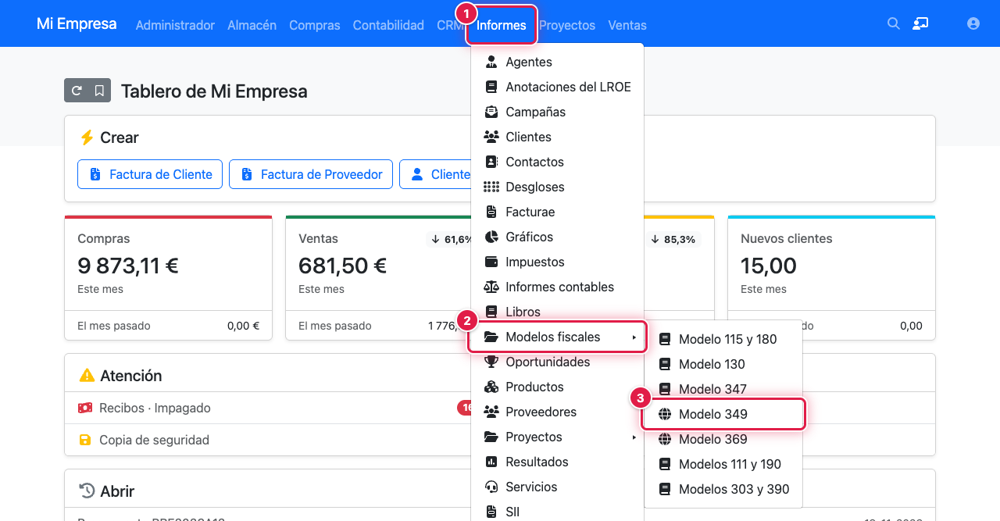
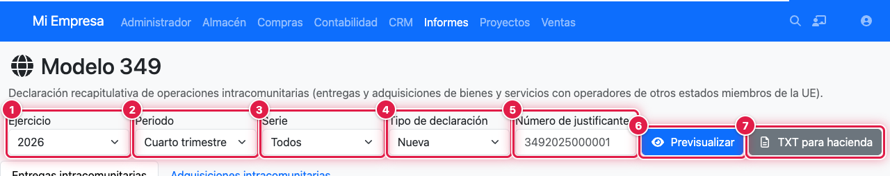
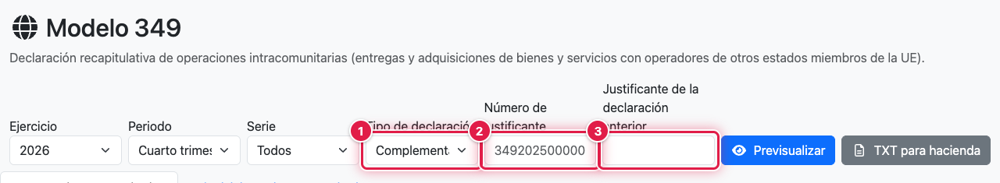
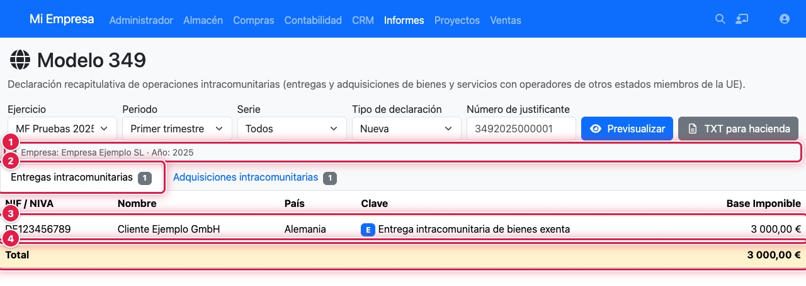
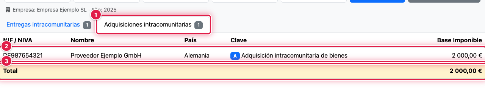
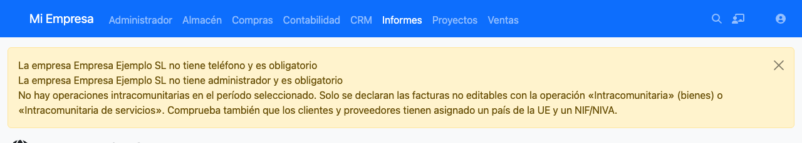

El **modelo 349** es la declaración recapitulativa de operaciones intracomunitarias: una declaración informativa, con la que no se paga ni se devuelve nada, en la que se detallan las compras y ventas de bienes y servicios con empresas y profesionales de otros países de la Unión Europea. El plugin **Modelo349** recoge esas operaciones de tus facturas de venta y de compra, las agrupa por operador y genera el fichero para presentarlo en la AEAT.

## 👥 ¿Quién tiene que presentarlo?

Tienes que presentarlo si realizas operaciones con empresas o profesionales de otros países de la UE y estás dado de alta en el registro de operadores intracomunitarios (ROI). Se declaran:

- Las **entregas de bienes** y las **prestaciones de servicios** a clientes de la UE (tus ventas exentas de IVA), incluidas las operaciones triangulares, las entregas posteriores a una importación exenta y los envíos y devoluciones de bienes en consigna.
- Las **adquisiciones de bienes** y los **servicios recibidos** de proveedores de la UE (tus compras).

La presentación suele ser trimestral y pasa a mensual cuando se superan los límites de entregas que marca la AEAT.

## ⚙️ Antes de empezar

El plugin solo cuenta una operación si cumple todo esto:

- La factura está **emitida** (no es un borrador ni se puede editar) y tiene en su campo **Operación** una operación intracomunitaria: **Intracomunitaria**, **Intracomunitaria de servicios** o, en las ventas, una de las que añade el plugin. De ahí sale la clave de la operación; está explicada en [Claves de operación del modelo 349](claves-de-operacion-del-modelo-349.md).
- El cliente o proveedor tiene un **país** de la UE distinto de España en su contacto (en las ventas, la dirección de facturación del cliente).
- El cliente o proveedor tiene su **CIF/NIF** informado, con el prefijo del país (por ejemplo `DE123456789`).
- La **empresa** declarante tiene indicados el **teléfono** y el **administrador**, que son obligatorios en el fichero oficial. Si faltan, el programa te avisa al calcular el modelo.

Si no ves el menú del paso siguiente, activa el plugin Modelo349 desde **menú Administrador** → **Plugins**.

## 📋 Cómo se rellena

1. Pulsa el menú **Informes**.
2. Pasa el ratón por **Modelos fiscales**.
3. Elige **Modelo 349**.

Ahora elige qué declaración quieres ver:

1. Elige el **Ejercicio**. La lista agrupa los ejercicios por empresa: el ejercicio que elijas decide qué empresa declara y qué año se declara.
2. Elige el **Periodo**: un trimestre o un mes. Al abrir la pantalla aparece el trimestre en curso.
3. Si solo quieres las facturas de una serie, elígela en **Serie**. Con **Todos** salen todas.
4. Elige el **Tipo de declaración**: **Nueva** para la declaración habitual del periodo, **Complementaria** para añadir operaciones a una declaración ya presentada o **Sustitutiva** para sustituirla por completo.
5. Escribe el **Número de justificante**, de hasta 13 cifras. Si lo dejas vacío, el programa genera uno con el formato 349, el año y 000001.
6. Pulsa **Previsualizar** para ver los datos en pantalla.
7. Cuando estén bien, pulsa **TXT para hacienda** para descargar el fichero.

Al cambiar el ejercicio, el periodo o la serie, el programa calcula los datos al momento sin pulsar nada más.

### Declaración complementaria o sustitutiva

Si en **Tipo de declaración** (1) eliges **Complementaria** o **Sustitutiva**, aparece un campo más, **Justificante de la declaración anterior** (3), donde escribes el número de justificante de la declaración que complementas o sustituyes. El **Número de justificante** (2) sigue siendo el de la declaración nueva.

## 📊 Revisar los datos en pantalla

Debajo de los filtros, una línea indica la empresa y el año que se declaran (1). Los resultados se reparten en dos pestañas (2), que muestran cuántos operadores tienen: **Entregas intracomunitarias**, con tus ventas, y **Adquisiciones intracomunitarias**, con tus compras.

Cada fila (3) es un operador y una clave de operación, con su **NIF / NIVA**, nombre, país, **Clave** y **Base imponible**. Si un operador tiene varias facturas en el periodo con la misma clave, aparecen sumadas en una sola fila. La última fila, **Total** (4), suma las bases de la pestaña.

La pestaña de compras funciona igual: la pestaña (1), una fila por operador (2) y el total (3).

Un operador solo aparece si la suma de sus facturas en esa clave es mayor que cero. Si las rectificativas dejan la suma en cero o en negativo, ese operador no sale.

### Avisos

Si el periodo no tiene operaciones, o a la empresa le falta el teléfono o el administrador, el programa lo indica en un aviso encima de la pantalla.

Si no sale ninguna operación que esperabas, repasa [Solución de problemas del modelo 349](solucion-de-problemas-del-modelo-349.md).

## 📥 Descargar el fichero para la AEAT

Pulsa **TXT para hacienda**. El programa vuelve a calcular el periodo con los filtros de la pantalla y descarga un fichero con el nombre `modelo_349_` seguido del código del ejercicio y del periodo, por ejemplo `modelo_349_MF25_1T.349`. Es un fichero de texto en el formato oficial de la AEAT, listo para subirlo en la presentación electrónica del modelo 349.

El fichero lleva un registro con los datos de la empresa declarante (NIF, nombre, teléfono, administrador como persona de contacto, número de operadores e importe total) y un registro por cada fila de las pestañas, con el NIF del operador precedido del código de su país.

## ℹ️ Antes de presentar

- La clave **C** (sustitución del destinatario en una venta en consigna) no se calcula. Si tienes alguna de esas operaciones, añádela al presentar la declaración.
- Los datos de **rectificaciones** (número de operadores e importes rectificados) y el **NIF del representante legal** van vacíos para que los completes en la Sede de la AEAT si tu caso lo requiere.
- El **Número de justificante** tiene que ser el que corresponda a tu declaración.

Revisa siempre el resumen en pantalla y valida el fichero en la Sede de la AEAT antes de presentarlo.

## Ver también

- [Claves de operación del modelo 349](claves-de-operacion-del-modelo-349.md)
- [Solución de problemas del modelo 349](solucion-de-problemas-del-modelo-349.md)
- [API REST del modelo 349](../Dev/api-modelo-349.md)
